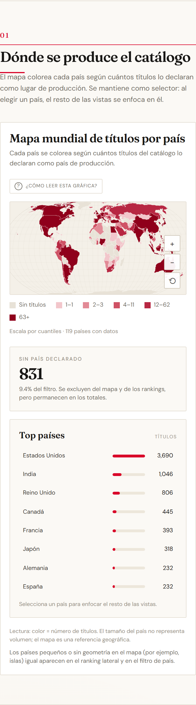
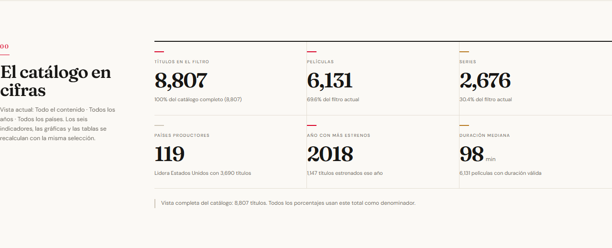

# Catálogo en foco

**La economía del entretenimiento: Netflix y tendencias globales.**

Un tablero editorial para explorar qué hay en el catálogo de Netflix, dónde se produce, cómo cambió con el tiempo y cómo se distribuye por género, formato y duración. Todas las cifras provienen del dataset público **Netflix Movies and TV Shows** de Kaggle, con corte al **25 de septiembre de 2021**.

[**Abrir el tablero**](https://eljonyjoe5.github.io/Dashboard-Netflix/) · [Informe de implementación · Fase 3 (PDF)](docs/Implementacion_Fase3.pdf)

## Una lectura en cinco cifras

| Indicador | Valor | Qué dice |
| --- | ---: | --- |
| Títulos en el catálogo | **8,807** | El total del snapshot, sin muestreo. |
| Películas | **6,131** | 69.6% del catálogo. |
| Series | **2,676** | 30.4% del catálogo. |
| Países productores | **119** | Producción declarada, no audiencia ni ingresos. |
| Año con más estrenos | **2018** | 1,147 títulos estrenados ese año. |

## Qué puedes explorar

- **Panorama general.** Los indicadores principales del catálogo y una lectura rápida de su composición.
- **Mapa mundial.** Producción declarada por país, con escala de color, ranking lateral y filtro por región.
- **Evolución en el tiempo.** Dos relojes: cuándo se estrenó cada título y cuándo llegó al catálogo.
- **Géneros.** Una nube para la impresión rápida y un ranking con las cifras exactas.
- **Formato y clasificaciones.** Películas frente a series, y clasificación de edad declarada.
- **Rankings, patrones y duración.** Países y directores con más títulos, matriz por década y mes, e histograma de duración.
- **Hallazgos y metodología.** Lecturas de conjunto y los límites del dato, explicados dentro del tablero.

Cada visualización incluye una ayuda para leerla, su leyenda y una nota de cuidado. Los filtros de tipo, periodo y país o región afectan a todas las vistas.

## Capturas

| Escritorio · 1440 px | Móvil · 390 px |
| --- | --- |
|  |  |

## Los tres informes

| Informe | Páginas | Contenido |
| --- | ---: | --- |
| [Fase 1 · Justificación](docs/Justificacion_Fase1.pdf) | 12 | Pregunta, audiencia, objetivos, preprocesamiento y elección del tipo de tablero. |
| [Fase 2 · Diseño visual](docs/Diseno_Fase2.pdf) | 13 | KPIs, gráficos, paleta, tipografía, retícula y wireframes. |
| [Fase 3 · Implementación](docs/Implementacion_Fase3.pdf) | 17 | Correspondencia diseño → código, arquitectura, KPIs, gráficos, mapa y verificación. |

Los informes también están disponibles desde el pie del tablero.

## Cómo leer el tablero

- **El total manda.** El KPI principal es el número de títulos que cumplen los filtros activos; todas las vistas comparten ese denominador.
- **El mapa es un selector.** Al elegir un país, el resto de las vistas se enfoca en él, pero el mapa conserva todos los países para permitir otra selección.
- **Los porcentajes pueden superar 100%.** Un título puede tener hasta tres géneros y declarar varios países; cada categoría cuenta por separado.
- **2021 está incompleto.** El corte es el 25 de septiembre; la caída del último año no significa que el catálogo haya dejado de crecer.
- **No hay dinero ni audiencia.** El dataset no contiene ingresos, precios, costo de producción ni espectadores. El tablero no los estima.

## Metodología en breve

Los datos se procesaron con un ETL reproducible en Python y DuckDB. Se separaron películas y series, se normalizaron países y géneros, se corrigieron tres filas con la duración desalineada y se documentaron los faltantes.

- **Sin imputación:** 831 títulos no declaran país (9.44%) y 2,634 no declaran director (29.91%). Se excluyen del mapa y de los rankings, pero permanecen en los totales.
- **País multivaluado:** un título puede sumar en varios países; por eso los totales geográficos no coinciden con el total del catálogo.
- **Regiones propias:** los 119 países se agrupan en seis regiones operativas. Es una clasificación del proyecto, no una norma de Netflix.
- **Duración separada:** los minutos se analizan solo para películas y las temporadas solo para series. Nunca se promedian juntos.

El detalle completo, campo por campo, está en la [Fase 1](docs/Justificacion_Fase1.pdf) y en la metodología del tablero.

## Ficha del proyecto

| Ficha | Detalle |
| --- | --- |
| **Estudiante** | Jonathan Alexander Gonzalez Romero |
| **Docente** | Jessica Carmin Mendiola Fuentes |
| **Materia** | Visualización de datos · Proyecto 3 |
| **Tema** | Negocios y cultura digital |
| **Fuente** | [Netflix Movies and TV Shows](https://www.kaggle.com/datasets/shivamb/netflix-shows) · `shivamb/netflix-shows` |
| **Snapshot** | 25 de septiembre de 2021 |
| **Cobertura** | 8,807 títulos · 119 países · 42 géneros |

## Créditos

- **Dataset:** Shivam Bansal. *Netflix Movies and TV Shows*. Kaggle, 2021.
- **Tipografías:** Fraunces y DM Sans.
- **Construido con:** React, TypeScript, Vite, Recharts, react-simple-maps, d3-cloud y DuckDB.

---

> Análisis independiente con fines educativos. No está afiliado, patrocinado ni respaldado por Netflix.
