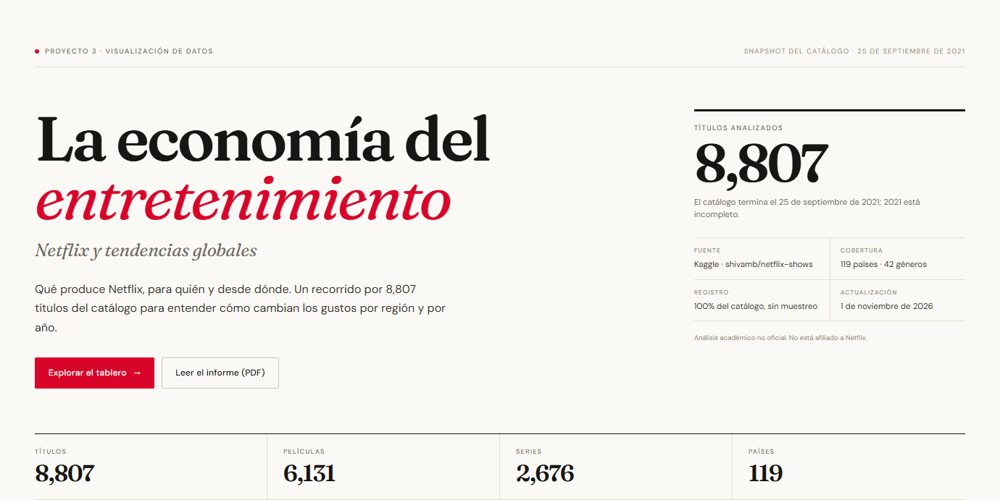
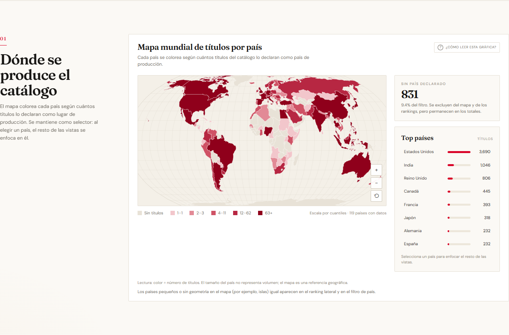

# Catálogo en foco · La economía del entretenimiento

**Catálogo en foco** es un tablero editorial sobre la producción de Netflix a partir del dataset público **Netflix Movies and TV Shows** de Kaggle. El proyecto combina un ETL reproducible con DuckDB, un tablero en React + TypeScript y tres informes PDF: justificación, diseño visual e implementación. Todas las cifras se calculan desde el CSV; no hay datos inventados ni valores de relleno.

| Ficha | Detalle |
| --- | --- |
| **Estudiante** | Jonathan Alexander Gonzalez Romero |
| **Docente** | Jessica Carmin Mendiola Fuentes |
| **Materia** | Visualización de datos · Proyecto 3 |
| **Tema** | Negocios y cultura digital |
| **Fuente** | [Netflix Movies and TV Shows](https://www.kaggle.com/datasets/shivamb/netflix-shows) · `shivamb/netflix-shows` |
| **Snapshot** | 25 de septiembre de 2021 |
| **Cobertura** | 8,807 títulos · 119 países · 42 géneros |

> Análisis independiente con fines educativos. No está afiliado, patrocinado ni respaldado por Netflix.

---

## 1. Qué contiene el proyecto

- **Tablero responsive** con filtros globales de tipo, periodo y país o región. Todos los KPIs y las visualizaciones usan el mismo conjunto filtrado.
- **Cuatro visualizaciones obligatorias**: mapa mundial de producción, evolución temporal, géneros y tipo de contenido con clasificaciones.
- **Visualizaciones complementarias**: rankings de países y directores, patrones por década y mes, y distribución de duración.
- **ETL reproducible** en Python + DuckDB que genera Parquet, una base DuckDB, `quality_report.json` y `dashboard.json`.
- **Informe PDF de la Fase 1** de 12 páginas con índice, análisis de audiencia, definición de objetivos, preprocesamiento (variables, limpieza, atípicos e integración), comparación y justificación del tipo de tablero, evidencia visual, límites y conclusiones.
- **Informe PDF de la Fase 2** de 13 páginas con la estructura visual previa a la implementación: KPI principal y secundarios, tipo de gráfico por indicador, paleta y contraste, tipografía, retícula, wireframes y jerarquía visual N1–N3.
- **Informe PDF de la Fase 3** de 17 páginas con la correspondencia entre el diseño aprobado y el tablero en código: estructura del proyecto, arquitectura de datos, justificación técnica, implementación de KPIs, gráficos y mapa, paleta y estilos, problemas y soluciones, reflexión técnica y verificación.
- **Capturas** de escritorio (1440 px) y móvil (390 px) en `docs/img/`.
- **Workflow de GitHub Pages** listo para publicar, sin ejecutar ningún despliegue desde este entorno.

## 2. Vista rápida





| Escritorio · 1440 px | Móvil · 390 px |
| --- | --- |
|  |  |

## 3. Cómo ejecutarlo en local

### Requisitos

- Node.js 20 o superior.
- Python 3.10 o superior.
- Google Chrome (solo para regenerar el PDF).

### Instalación

```powershell
# 1. Dependencias de Python
python -m venv .venv
.venv\Scripts\Activate.ps1
pip install -r requirements.txt

# 2. Dependencias del tablero
npm install --legacy-peer-deps
```

`--legacy-peer-deps` es necesario porque `react-simple-maps@3` declara compatibilidad con React 18 y el proyecto usa React 19. El tablero funciona correctamente con esa combinación.

### Desarrollo y compilación

```powershell
npm run dev       # servidor local en http://127.0.0.1:5173/
npm run build     # TypeScript + build de producción en dist/
npm run preview   # vista previa en http://127.0.0.1:4173/
```

### Regenerar datos e informe

```powershell
python etl/build_dataset.py   # lee netflix_titles.csv y reescribe data/ y public/data/
npm run pdf                   # genera docs/Justificacion_Fase1.pdf y su copia pública
npm run pdf:fase2             # genera docs/Diseno_Fase2.pdf y su copia pública
npm run pdf:fase3             # genera docs/Implementacion_Fase3.pdf y su copia pública
```

El ETL requiere que `netflix_titles.csv` esté en la raíz del proyecto. También acepta otra ruta:

```powershell
python etl/build_dataset.py --csv "C:\ruta\netflix_titles.csv"
```

## 4. Dataset y diccionario de datos

**Archivo:** `netflix_titles.csv` · 3.4 MB · SHA-256 `df1f4ad2…f3f3` · 8,807 filas × 12 columnas.

| Campo | Tipo | Uso en el tablero |
| --- | --- | --- |
| `show_id` | Identificador | Clave única; no se muestra. |
| `type` | Categórico | Película o serie. |
| `title` | Texto | Nombre del título. |
| `director` | Multivaluado | Ranking de directores; 29.91% sin dato. |
| `cast` | Multivaluado | Contexto; no se usa en los KPIs. |
| `country` | Multivaluado | Mapa, rankings y filtro por país o región. |
| `date_added` | Fecha | Año y mes de incorporación al catálogo. |
| `release_year` | Entero | Año de estreno; base del filtro de periodo. |
| `rating` | Categórico | Clasificación de edad declarada. |
| `duration` | Texto | Minutos para películas; temporadas para series. |
| `listed_in` | Multivaluado | Géneros; hasta 3 por título. |
| `description` | Texto | Sin uso analítico; se conserva en la base. |

### Calidad del dato

| Campo | Nulos | % | Distintos | Tratamiento |
| --- | ---: | ---: | ---: | --- |
| `show_id` | 0 | 0.00% | 8,807 | Clave única. |
| `type` | 0 | 0.00% | 2 | Traducido a Película / Serie. |
| `title` | 0 | 0.00% | 8,806 | “Consequences” aparece dos veces con ID distinto; no es duplicado. |
| `director` | 2,634 | 29.91% | 4,528 | No se imputa; queda fuera del ranking. |
| `cast` | 825 | 9.37% | 7,692 | Se conserva sin imputar. |
| `country` | 831 | 9.44% | 748 | 119 países tras separar y normalizar; los vacíos no se pintan. |
| `date_added` | 10 | 0.11% | 1,714 | Fecha inválida; se conserva el título sin fecha. |
| `release_year` | 0 | 0.00% | 74 | Entero válido entre 1925 y 2021. |
| `rating` | 7 | 0.08% | 14 | 3 filas desalineadas corregidas; 7 quedan sin clasificación. |
| `duration` | 3 | 0.03% | 220 | Minutos recuperados desde `rating`; 0 títulos sin duración. |
| `listed_in` | 0 | 0.00% | 514 | 42 géneros tras separar y traducir etiquetas. |
| `description` | 0 | 0.00% | 8,775 | Sin uso analítico. |

Duplicados: **0** por `show_id` y **0** filas completas. Años sin títulos: **23** entre 1925 y 2021; se muestran en cero, sin interpolar.

## 5. Reglas de limpieza aplicadas

Estas reglas se presentaron antes de transformar los datos y se documentan también en el PDF y en el reporte de calidad.

1. **Tipo:** `Movie` → `Película`; `TV Show` → `Serie`. Se conserva el valor original en la base.
2. **Fechas:** `date_added` se parsea como `Month D, YYYY`; se derivan año, mes y trimestre. Las 10 fechas inválidas quedan nulas.
3. **Duración:** se separan minutos (películas) y temporadas (series). Nunca se promedian juntas.
4. **Tres filas desalineadas:** en `s5542`, `s5795` y `s5814` la duración estaba en `rating`. Los minutos se movieron a `duration_min` y su clasificación queda como desconocida.
5. **Países:** separación por comas, `trim` y `primary_country` = primer país. Se normalizaron nombres históricos: West Germany + East Germany → Germany (+6 títulos); Soviet Union → Russia (+3).
6. **Géneros:** se conserva el nombre original en inglés y se agrega una etiqueta en español para la interfaz.
7. **Sin país / sin director:** no se imputan. Se excluyen del mapa y de los rankings, pero permanecen en los totales y en los porcentajes.
8. **Incorporación anterior al estreno:** 14 casos se conservan y se marcan; casi todos son series cuya `release_year` corresponde a la última temporada.
9. **Años sin títulos:** se muestran en cero; no se interpola ni se extrapola.
10. **Regiones:** los 119 países se agrupan en 6 regiones operativas (América del Norte, América Latina y el Caribe, Europa, África, Asia y Oceanía). Es una clasificación propia del proyecto, no una norma de Netflix.

## 6. Indicadores principales

| Indicador | Valor | Lectura |
| --- | ---: | --- |
| Títulos en el catálogo | 8,807 | 100% del snapshot, sin muestreo. |
| Películas | 6,131 | 69.6% del total. |
| Series | 2,676 | 30.4% del total. |
| Países productores | 119 | Producción declarada, no audiencia. |
| Año con más estrenos | 2018 | 1,147 títulos. |
| Año con más incorporaciones | 2019 | 2,016 títulos. |
| Últimos 5 años | 93.45% | 8,230 títulos incorporados entre 2017 y 2021. |
| Clasificación más frecuente | TV-MA | 3,207 títulos (36.41%). |
| Mediana de películas | 98 min | Promedio: 99.6 min; rango 3–312. |
| Mediana de series | 1 temporada | Máximo: 17 temporadas. |
| Sin país declarado | 831 | 9.44% del catálogo. |
| Sin director | 2,634 | 29.91% del catálogo. |

**Definiciones clave**

- **Últimos 5 años:** títulos con `added_year >= 2017`. El denominador es el total del filtro.
- **Periodo:** filtra por `release_year`, no por `date_added`. La serie temporal muestra cuándo llegaron esos mismos títulos al catálogo.
- **Porcentajes de género y país:** usan el total de títulos como denominador; pueden sumar más de 100% porque un título puede tener hasta 3 géneros y declarar varios países.
- **2021:** está incompleto (corte al 25 de septiembre). No debe compararse como año cerrado.

## 7. Visualizaciones

### Obligatorias

1. **Mapa mundial de producción** (`#mapa`): coroplético por país con escala de cuantiles y ranking lateral. El color representa cantidad de títulos, no audiencia ni ingresos. Al hacer clic en un país, el resto de las vistas se enfoca; el mapa conserva todos los países como selector.
2. **Evolución en el tiempo** (`#tiempo`): dos relojes en una vista. Se alterna entre año de estreno y año de incorporación. La línea punteada marca el corte del snapshot.
3. **Géneros** (`#generos`): nube de palabras para la impresión rápida y ranking con cifras exactas. La lista ordenada es la alternativa accesible; los nombres largos se abrevian solo en la nube.
4. **Tipo y clasificaciones** (`#tipos`): donut de películas vs. series y barras de clasificación de edad. Las barras excluyen los 7 títulos sin rating; el donut usa el total filtrado.

### Complementarias

- **Rankings** (`#rankings`): países y directores con más títulos.
- **Patrones** (`#patrones`): matriz por década y por mes de incorporación.
- **Duración** (`#duracion`): histograma de minutos para películas y distribución de temporadas para series, siempre separados.
- **Hallazgos** (`#hallazgos`): tarjetas con lecturas globales del catálogo; se indica que no cambian con los filtros.

Cada tarjeta incluye una ayuda “¿Cómo leer esta gráfica?”, la leyenda, la explicación de ejes y una nota de cuidado. Las visualizaciones también tienen tablas o listas equivalentes.

## 8. Experiencia y accesibilidad

- Diseño editorial en papel cálido `#fbf9f5`: tinta, acento rojo `#d90429` y tipografías **Fraunces** (titulares) y **DM Sans** (texto).
- Distribución con riel de secciones sticky, hero asimétrico, franja horizontal de KPIs y tarjetas blancas de gráfica.
- Filtros globales con contador de títulos y chip de país activo.
- Barra de progreso de lectura, navegación activa y revelados al hacer scroll.
- Contadores animados en los KPIs; se desactivan con `prefers-reduced-motion`.
- Sin desbordamiento horizontal a 390 px: tablas y matrices hacen scroll dentro de su contenedor.
- Mapa navegable por teclado, con `aria-label`, roles de botón y activación con Enter/Espacio.
- Alternativas textuales: lista ordenada para la nube, tablas para rankings y matrices.
- Enlaces a los informes de Fase 1, Fase 2 y Fase 3, y al reporte de calidad desde el pie del tablero.

## 9. Reproducibilidad

```text
netflix_titles.csv
   └─> DuckDB (staging + tablas normalizadas)
        ├─> data/parquet/*.parquet
        ├─> data/netflix_catalog.duckdb
        ├─> data/quality_report.json
        └─> public/data/dashboard.json
             └─> React + TypeScript + Vite (dist/)
```

| Etapa | Archivo | Salida |
| --- | --- | --- |
| Perfilado inicial | `scripts/profile_raw.py` | Diagnóstico del CSV crudo. |
| ETL | `etl/build_dataset.py` | Parquet, DuckDB, calidad y `dashboard.json`. |
| Normalización de países | `etl/country_meta.json` | 119 países, ISO y región. |
| Etiquetas de género | `etl/genre_labels.json` | 42 etiquetas en español. |
| Tablero | `src/` | Interfaz y agregados en el cliente. |
| Informe Fase 1 | `docs/generate_pdf.py` | HTML imprimible y PDF A4 de 12 páginas. |
| Informe Fase 2 | `docs/generate_pdf_fase2.py` | HTML imprimible y PDF A4 de 13 páginas. |
| Informe Fase 3 | `docs/generate_pdf_fase3.py` | HTML imprimible y PDF A4 de 17 páginas. |

El tablero carga `public/data/dashboard.json` (≈0.55 MB) y recalcula los agregados filtrados en el navegador. El archivo incluye filas compactas por título, agregados del ETL, KPIs, hallazgos y el reporte de calidad completo.

## 10. Informes PDF

### Fase 1 · Justificación

- **Ruta:** [`docs/Justificacion_Fase1.pdf`](docs/Justificacion_Fase1.pdf)
- **Copia pública:** [`public/docs/Justificacion_Fase1.pdf`](public/docs/Justificacion_Fase1.pdf)
- **Extensión:** 12 páginas A4.
- **Contenido:**
  1. Portada editorial con ficha técnica.
  2. Índice y resumen en una frase.
  3. **Análisis de la audiencia:** perfiles, decisiones y nivel de detalle requerido.
  4. **Definición de objetivos:** problema, pregunta, objetivo general, objetivos específicos y ejemplo de uso.
  5. **Preprocesamiento · variables:** identificación de campos, roles y variables derivadas.
  6. **Preprocesamiento · limpieza:** faltantes, duplicados y criterios de atípicos (cercos de Tukey).
  7. **Preprocesamiento · integración:** tablas puente, normalización y modelo analítico.
  8. **Selección del tipo de dashboard:** comparación operativo / táctico / estratégico.
  9. **Justificación:** por qué el tablero es táctico y cómo se refleja en la interfaz.
  10. **El tablero:** evidencia visual de portada y panel de indicadores.
  11. **Visualizaciones y lectura:** mapa, tiempo y géneros.
  12. **Cierre:** límites, reproducibilidad, referencias y conclusiones.

### Fase 2 · Diseño visual

- **Ruta:** [`docs/Diseno_Fase2.pdf`](docs/Diseno_Fase2.pdf)
- **Copia pública:** [`public/docs/Diseno_Fase2.pdf`](public/docs/Diseno_Fase2.pdf)
- **Extensión:** 13 páginas A4.
- **Contenido:**
  1. Portada editorial y ficha técnica.
  2. Índice y mapa de criterios de evaluación.
  3. **El diseño en una página:** pregunta, audiencia, datos, respuesta visual y cinco decisiones.
  4. **Punto de partida:** pregunta central, capas de audiencia y restricciones convertidas en decisiones.
  5. **KPI principal y secundarios:** 8,807 títulos como ancla y cuatro lecturas complementarias.
  6. **Justificación del KPI principal:** denominador común, efecto del filtro, escala y honestidad del dato.
  7. **Gráfico para cada KPI:** mapa, dona, barras, línea/área e histograma, con alternativas descartadas.
  8. **Paleta y accesibilidad:** cuatro colores base, proporción 70/20/7/3 y contrastes WCAG.
  9. **Tipografía, retícula y jerarquía:** escala, tokens, retícula de 12 columnas y niveles N1–N3.
  10. **Wireframe · primera pantalla:** título, ficha, KPIs, filtros y retícula marcada.
  11. **Wireframe · área de análisis:** mapa, tiempo, géneros, formato, duración y leyendas.
  12. **Cuadrícula y prioridad visual:** matriz 3 × 3, pesos y recorrido de lectura.
  13. **Responsive y accesibilidad:** 1440, 1024 y 390 px, puntos de quiebre, accesibilidad y estados del sistema.

### Fase 3 · Implementación

- **Ruta:** [`docs/Implementacion_Fase3.pdf`](docs/Implementacion_Fase3.pdf)
- **Copia pública:** [`public/docs/Implementacion_Fase3.pdf`](public/docs/Implementacion_Fase3.pdf)
- **Extensión:** 17 páginas A4.
- **Contenido:**
  1. Portada editorial con captura real del tablero.
  2. Índice y mapa de criterios de evaluación.
  3. **Introducción:** del wireframe al tablero en funcionamiento.
  4. **El tablero implementado:** primera pantalla y lectura de conjunto.
  5. **Correspondencia · primera pantalla:** wireframe de la Fase 2 frente a la implementación.
  6. **Correspondencia · área de análisis:** mapa, tiempo, géneros, formato y duración.
  7. **Estructura del proyecto:** árbol de carpetas y responsabilidad de cada capa.
  8. **Arquitectura y flujo de datos:** ETL, `dashboard.json`, `derive()` y contrato `Derived`.
  9. **Justificación técnica:** React, TypeScript, Recharts, react-simple-maps, d3-cloud y alternativas descartadas.
  10. **Implementación de KPIs:** tarjetas, contador animado, estados vacíos y filtros reales.
  11. **Implementación de gráficos:** una gráfica por pregunta y decisiones de conservación.
  12. **Tiempo y distribución:** la única variación de marca (línea/área → barras apiladas), documentada.
  13. **Implementación del mapa:** coroplético, cuantiles, regiones y honestidad del dato.
  14. **Paleta y estilos:** tokens, tipografía, contraste y estados.
  15. **Problemas y soluciones:** dependencias, geometría, nulos, 2021 incompleto y responsive.
  16. **Reflexión técnica:** qué se aprendió y qué queda como deuda.
  17. **Conclusión y verificación:** entregables, checklist y cierre.

Los tres PDF se regeneran con Chrome headless: `npm run pdf` para la Fase 1, `npm run pdf:fase2` para la Fase 2 y `npm run pdf:fase3` para la Fase 3. En Windows se busca Chrome en `Program Files`; en otros sistemas se puede definir `CHROME_PATH`.

## 11. Capturas

| Archivo | Vista |
| --- | --- |
| `docs/img/desktop-00-filtros.png` | Filtros globales. |
| `docs/img/desktop-01-inicio.png` | Portada. |
| `docs/img/desktop-02-panorama.png` | KPIs. |
| `docs/img/desktop-03-mapa.png` | Mapa mundial. |
| `docs/img/desktop-04-tiempo.png` | Serie temporal. |
| `docs/img/desktop-05-generos.png` | Nube y ranking de géneros. |
| `docs/img/desktop-06-tipos.png` | Tipo y clasificaciones. |
| `docs/img/desktop-07-rankings.png` | Rankings. |
| `docs/img/desktop-08-patrones.png` | Patrones por década y mes. |
| `docs/img/desktop-09-duracion.png` | Duración. |
| `docs/img/desktop-10-hallazgos.png` | Hallazgos. |
| `docs/img/desktop-11-metodologia.png` | Metodología. |
| `docs/img/mobile-01-inicio.png` … `mobile-07-metodologia.png` | Versión de 390 px. |

## 12. Publicación en GitHub Pages

El repositorio incluye `.github/workflows/deploy.yml`. El workflow compila con Node 20, ejecuta `npm run build` y publica `dist/` con las acciones oficiales de Pages.

### Configuración (solo cuando se decida publicar)

1. Crear el repositorio en GitHub y subir el proyecto.
2. En **Settings → Pages → Build and deployment**, elegir **Source: GitHub Actions**.
3. Hacer push a `main` o ejecutar el workflow manualmente desde **Actions**.

```powershell
git init
git add .
git commit -m "Proyecto 3: tablero Netflix"
git branch -M main
git remote add origin https://github.com/<usuario>/<repositorio>.git
git push -u origin main
```

La URL queda como `https://<usuario>.github.io/<repositorio>/`. El `base: './'` de Vite permite publicar tanto en la raíz como en una subruta, sin cambiar rutas.

> En este entorno no se ejecutaron commits, pushes ni despliegues: la publicación queda documentada y lista para cuando se autorice.

## 13. Límites del análisis

- **Snapshot, no panel vivo:** el catálogo termina el 25 de septiembre de 2021; 2021 está incompleto.
- **Sin dinero:** el dataset no contiene ingresos, precios, costo de producción ni audiencia. No se estiman.
- **País multivaluado:** un título puede sumar en varios países; los totales por país no suman el catálogo.
- **Datos faltantes:** 29.91% sin director y 9.44% sin país; no se imputan.
- **Regiones propias:** la agrupación en 6 regiones es operativa, no una norma de Netflix.
- **Correlación no es causalidad:** el tablero describe el catálogo; no explica por qué Netflix tomó cada decisión.
- **Sesgo de declaración:** país, director y reparto dependen de cómo se documentó cada título.

## 14. Estructura del repositorio

```text
.
├─ netflix_titles.csv          # Dataset original
├─ etl/
│  ├─ build_dataset.py         # ETL DuckDB → Parquet → JSON
│  ├─ country_meta.json        # 119 países, ISO y región
│  └─ genre_labels.json        # Etiquetas de género en español
├─ data/
│  ├─ netflix_catalog.duckdb
│  ├─ parquet/
│  └─ quality_report.json
├─ public/
│  ├─ data/dashboard.json
│  ├─ data/quality_report.json
│  ├─ docs/Justificacion_Fase1.pdf
│  ├─ docs/Diseno_Fase2.pdf
│  ├─ docs/Implementacion_Fase3.pdf
│  └─ favicon.svg
├─ src/
│  ├─ components/              # Header, Hero, filtros, KPIs, gráficas
│  ├─ lib/                     # Agregados y formato es-MX
│  ├─ hooks/                   # Scroll, navegación activa
│  └─ styles/global.css
├─ docs/
│  ├─ Justificacion_Fase1.pdf
│  ├─ Diseno_Fase2.pdf
│  ├─ Implementacion_Fase3.pdf
│  ├─ generate_pdf.py
│  ├─ generate_pdf_fase2.py
│  ├─ generate_pdf_fase3.py
│  ├─ img/                     # Capturas de escritorio y móvil
│  └─ img/f3/                  # Evidencia de correspondencia Fase 2 → Fase 3
├─ scripts/profile_raw.py      # Perfilado del CSV
├─ .github/workflows/deploy.yml
├─ requirements.txt
└─ package.json
```

## 15. Créditos

- **Dataset:** Shivam Bansal. *Netflix Movies and TV Shows*. Kaggle, 2021.
- **Herramientas:** DuckDB, React, TypeScript, Vite, Recharts, react-simple-maps, d3-cloud, world-atlas.
- **Tipografías:** Fraunces y DM Sans (Fontsource).
- **Proyecto:** Visualización de datos · Proyecto 3 · Negocios y cultura digital.

---

**Nota de honestidad intelectual:** las cifras del tablero y del PDF salen del CSV y del ETL. El proyecto no estima ingresos, audiencia ni rentabilidad; cuando el dataset no permite responder una pregunta, se dice explícitamente.
